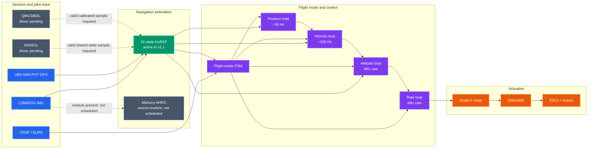

# System Architecture

This document describes the Drone OS v1.1 source layout and runtime data flow. The pin allocation is a software-side plan; the source package does not contain the generated STM32Cube project or prove that the board has been wired accordingly.

## System data flow

Solid arrows identify active runtime paths. Dotted arrows mark pending sensor inputs or source modules that are not scheduled.

The v1.1 system loop runs InvEKF for navigation and attitude. Mahony AHRS source is present, but startup does not schedule it or route its output into the control loop. The NMPC-RTI scaffold is intentionally outside this active path.

## Source organization

| Directory | Responsibility |
|---|---|
| src/core/ | Shared state, RTOS tasks, peripheral callbacks, startup |
| src/math/ | Fixed-size vectors and quaternion operations |
| src/estimation/ | Active InvEKF navigation filter and Mahony AHRS source module |
| src/drivers/ | LSM6DSV IMU and startup calibration helper |
| src/communication/ | CRSF receiver parser and UBX NAV-PVT parser |
| src/control/ | PID cascade and future NMPC-RTI interface |
| src/flight_modes/ | Disarmed/armed, FPV, camera, failsafe, and landing states |
| src/actuation/ | X-frame mixer and bidirectional DShot output/telemetry |
| src/safety/ | Receiver, IMU, tilt, battery, geofence, motor, and watchdog checks |
| src/simulation/ | HIL/SIL input and motor-output hooks |

## Runtime schedule

| Task/path | Nominal rate | Status |
|---|---:|---|
| IMU/control/FSM | 3840 Hz | IMU DRDY paced in source; target clock/IRQ setup external |
| InvEKF nominal propagation | every IMU sample | Active |
| InvEKF covariance prediction | 480 Hz | Every eight IMU samples |
| Gravity observation | about 101 Hz | Decimated accelerometer update |
| Camera velocity controller | about 101 Hz | Every 38 IMU ticks |
| Camera position controller | about 49.9 Hz | Every 77 IMU ticks; GPS/hold gated |
| GPS task | 10 Hz | UBX bytes parsed; local origin set from first valid fix |
| Barometer task | 50 Hz | State consumer exists; sensor driver absent |
| Magnetometer task | 100 Hz | State consumer exists; sensor driver/calibration absent |
| CRSF task | polling | Receives UART bytes and applies receiver timeout |
| Safety task | 100 Hz | Safety checks and watchdog feed in source |
| MAVLink task | 10 Hz | Placeholder; no messages are generated |
| Logger task | queue/polling | Placeholder; no FatFS write path |

Rates are source-level scheduling targets and need measurement on the configured MCU.

## Estimation

InvEKF is a 15-state right-invariant navigation filter with attitude, velocity, position, gyro bias, and accelerometer bias error coordinates. Its nominal state propagates with each IMU sample. Covariance propagation is decimated to 480 Hz. Gravity updates are scheduled at roughly 100 Hz. GPS position and velocity are transformed from latitude/longitude/altitude into local NED using the first accepted fix as origin.

The estimator API also supports barometer and magnetometer observations. The corresponding tasks currently consume valid samples from shared state; physical sampling, scaling, magnetometer calibration, and local magnetic reference setup are unfinished.

The Mahony AHRS implementation is included as a high-rate attitude-estimation module. It is not currently instantiated or scheduled by system startup, so the active controller receives attitude from InvEKF.

## Flight-control paths

### FPV / Acro

CRSF roll, pitch, and yaw commands become body-rate setpoints. The rate controller compares these commands with body gyro measurements and produces torque commands. The outer attitude, velocity, and position loops are bypassed.

### Camera / stabilized

When camera mode is selected, pilot sticks map to heading-relative NED velocity commands. The velocity loop turns velocity error into bounded tilt and thrust corrections. The attitude loop generates body-rate commands from a quaternion attitude error; the rate loop and mixer produce motor commands.

When the receiver requests hold and GPS is valid, the position controller captures/updates position setpoints and supplies velocity setpoints to the velocity loop. Position hold is not available without a valid GPS fix. The source uses the receiver field name altHold for a hold request that gates both horizontal and vertical position control.

### Failsafe and landing

RC loss, critical battery, or geofence faults can request failsafe. On entry, the FSM initializes camera-style control, captures yaw, resets outer-loop state, and ramps a positive NED-down velocity target. Landing logic requires valid barometer data, low AGL altitude, and low vertical speed. The behavior is source-implemented but not validated as a safety guarantee. No return-to-home path is implemented.

## Peripheral and application status

- **IMU:** LSM6DSV driver source is present. Sensor identity, scale, ODR, axes, and SPI timing must be confirmed on target.
- **GPS:** UBX NAV-PVT parsing, USART receive callback, local-origin conversion, fusion, and stale-fix timeout are in source.
- **Barometer:** MS5611 readout and driver are not implemented.
- **Magnetometer:** QMC5883L readout, calibration, and magnetic reference are not implemented.
- **RC:** CRSF parser/task source is present; verify the configured UART and ISR behavior.
- **DShot:** output and bidirectional receive code are present. Validate compressed eRPM period conversion, callbacks, DMA, ESC compatibility, motor mapping, and timing on the board.
- **MAVLink:** USB CDC task exists as a placeholder; message serialization and sending are not implemented.
- **Logging:** logger task exists as a placeholder; queue records, FatFS integration, and flush behavior are not implemented.
- **Simulation:** state injection and motor-output callback hooks exist; a transport, simulator model, and closed-loop validation are separate work.
- **Calibration:** startup gyro-calibration helper exists but is not called by the system startup path and needs timeout/fault handling.

## Build and board integration

This source tree has no .ioc, generated HAL source, linker script, startup code, Makefile, CMake project, or other complete target build metadata. Integrate it with the matching STM32Cube project and verify:

- MCU clock tree and USB 48 MHz clock.
- SPI/I2C modes, rates, chip-select GPIO, and sensor timing.
- UART alternate functions, half-duplex setup, DMA/interrupt routing, and callback ownership.
- ADC channels, analogue sampling times, and divider/current-sensor calibration.
- IMU EXTI, CRSF/GPS receive behavior, NVIC priorities, and RTOS-safe ISR calls.
- USB CDC, CMSIS-RTOS v2, IWDG, and DWT setup.
- Physical pin assignments against the PCB schematic.

See [the pin allocation notes](drone_fc/src/pins.md), [setup guide](drone_fc/README.md), and [control/estimator reference](drone_fc/process.md).
