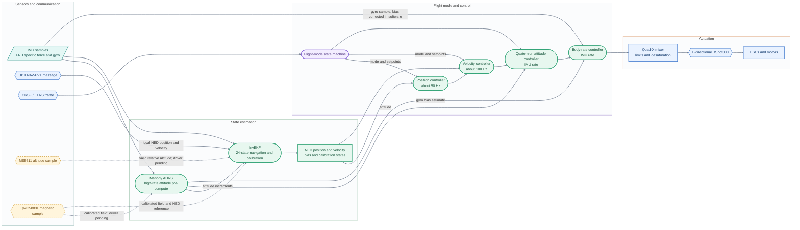
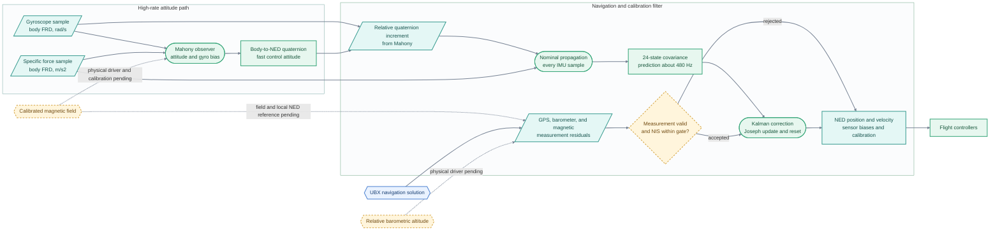
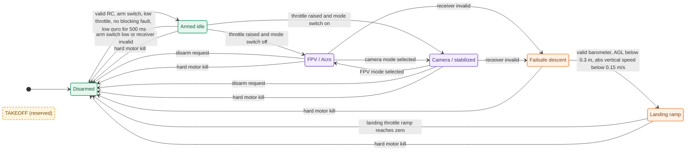
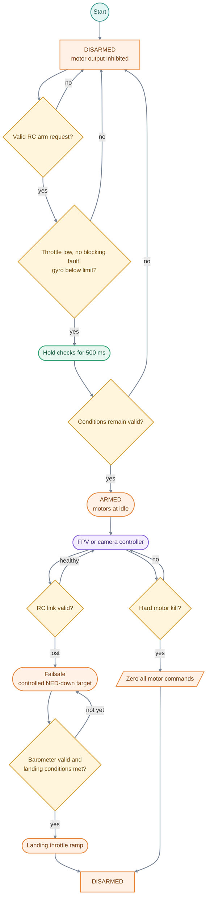
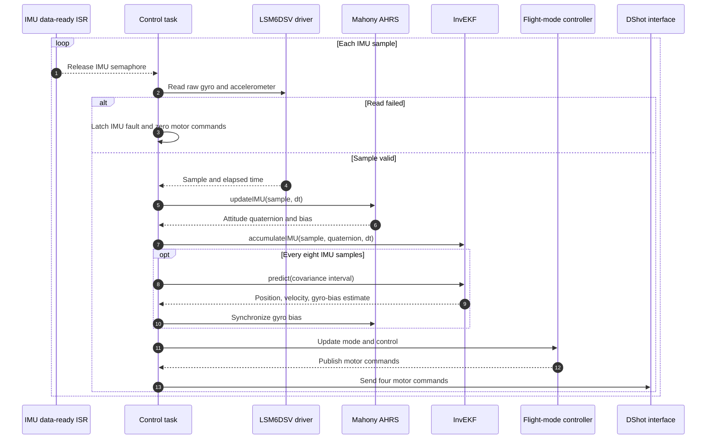
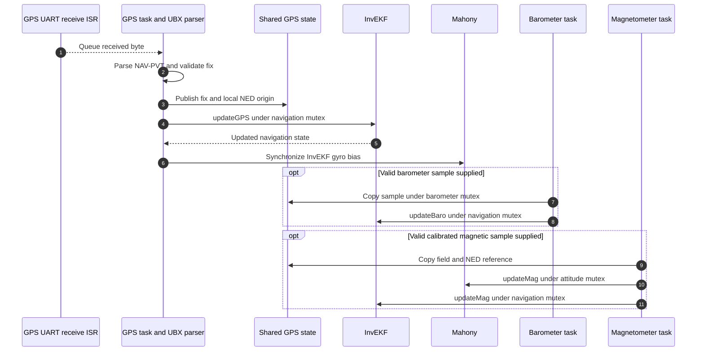
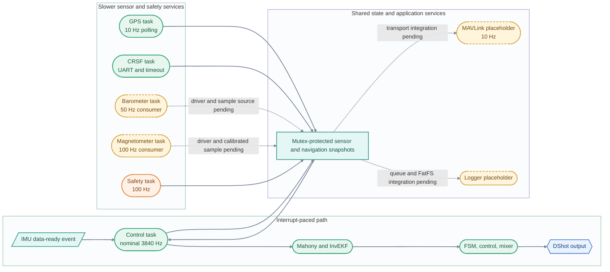
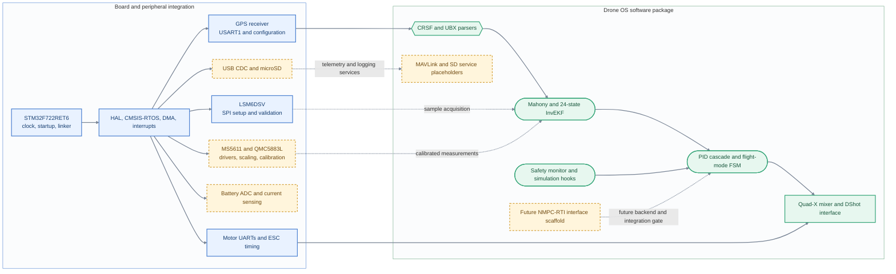
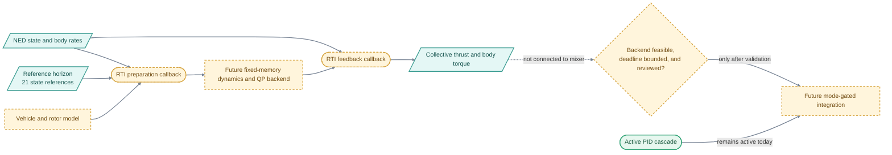

# System Architecture

This document is the final-state design plan for Drone OS v1.1. It describes the intended flight stack, the estimator and control data paths, real-time task interactions, safety states, and the hardware boundary. Each diagram is paired with prose and status notes so the plan does not imply that an unfinished driver or target integration already exists.

The design retains the high-rate Mahony attitude pre-computation as a deliberate part of the estimator chain. The upgrade replaces the navigation Kalman filter with the 24-state invariant EKF; it does not remove or demote Mahony.

## Visual language and diagram conventions

The diagrams use grouped lanes and left-to-right flow for the Myovena layout style. Shape and color carry meaning consistently across the set.

| Visual family | Color | Use |
|---|---|---|
| System and control | Green | Estimator, controller, task, and software responsibility |
| Hardware and communication | Blue | MCU, buses, protocols, drivers, and physical interfaces |
| Sensing, data, and feedback | Teal | Measurements, state values, setpoints, and feedback signals |
| Companion and configuration | Purple | Flight modes, shared configuration, and mode selection |
| Safety, fault, and inhibit | Orange | Arming, failsafe, kill, and landing logic |
| Checks and open integration | Amber | Decisions, validation gates, and work awaiting implementation |

Rectangular blocks identify architecture components or stored state. Rounded blocks identify work performed by a function, task, or controller. Parallelograms identify data channels. Diamonds identify decisions. Hexagons identify protocol messages. Outlined frames group a subsystem or an ownership boundary. The state diagram uses a filled initial marker.

Solid connectors show a source-level path present in this package or a direct dependency in the intended design. Dashed connectors show a planned interface whose acquisition, calibration, backend, or board integration remains incomplete. Connector labels name the data or condition crossing the boundary. Amber nodes indicate checks or integration work that still needs implementation or target validation.

## 1. System context

The overview connects the sensor and pilot inputs to the two estimator paths, cascaded controllers, and motor interface. Mahony processes every IMU sample and supplies low-latency attitude to the control loop. InvEKF follows Mahony's attitude increments while propagating navigation and calibration states. The outer loops consume InvEKF position and velocity; the fast attitude and rate loops use the Mahony attitude and bias-corrected gyro rate.



The active source path includes the IMU driver, Mahony, InvEKF, UBX parser and GPS fusion, flight-mode controller, mixer, and DShot output. The barometer and magnetometer tasks currently consume externally supplied shared-state samples; the physical MS5611 and QMC5883L drivers, calibration, and reference-field setup remain to be completed. The dashed edges are the intended measurement interfaces, not evidence that those devices are ready to fly.

## 2. Estimation architecture and state ownership

The two estimators have distinct jobs. Mahony uses gyro integration with accelerometer tilt correction and optional magnetic correction to produce a high-rate attitude. InvEKF uses that attitude's relative quaternion increments together with the same inertial samples to propagate its navigation nominal state. Its covariance is predicted at the slower configured interval, and external measurement updates correct navigation and calibration states.



The InvEKF retains the requested 24 error coordinates. The first nine form a body-frame invariant tangent; the remaining states are additive body-frame sensor biases, a scalar actuator parameter, barometer calibration, and NED wind.

| Index | Size | State | Coordinates |
|---|---:|---|---|
| 0–2 | 3 | Attitude error, δθ | Body-frame invariant tangent |
| 3–5 | 3 | Velocity error, δv | Body-frame invariant tangent |
| 6–8 | 3 | Position error, δp | Body-frame invariant tangent |
| 9–11 | 3 | Gyroscope bias, bg | Body FRD, rad/s |
| 12–14 | 3 | Accelerometer bias, ba | Body FRD, m/s2 |
| 15 | 1 | Motor time constant, τm | Seconds |
| 16–18 | 3 | Magnetometer bias, bm | Body FRD, µT |
| 19 | 1 | Barometer bias, bh | Metres |
| 20 | 1 | Barometer scale, sh | Fractional scale error |
| 21–23 | 3 | Wind, w | NED, m/s |
| **Total** | **24** | | |

The nominal quaternion maps body FRD into NED. The first nine error coordinates use the body-frame error Xhat inverse times X, often described as a left-invariant error in the SE_2(3) convention used by this implementation. Injection is q+ = q Exp(δθ/2), v+ = v + R(q)δv, and p+ = p + R(q)δp. Stating the error definition matters because invariant-filter naming differs among references; the equations and frame convention determine the implementation. A useful reference is the [$SE_2(3)$ based Extended Kalman Filtering and Smoothing Framework](https://arxiv.org/abs/2102.12897).

At each IMU tick, the filter advances its nominal position and velocity using midpoint attitude, bias-corrected specific force, NED gravity, and configured linear drag relative to the wind state. It follows Mahony's shortest signed quaternion increment instead of integrating a second copy of the attitude solution. The covariance uses a third-order transition approximation and two-node Gauss-Legendre integration of continuous process noise. All workspaces are fixed-size.

The GPS residuals are kept in NED with their receiver-reported horizontal, vertical, and speed uncertainty. The observation Jacobian rotates body-frame invariant errors into NED, preserving the axis-dependent measurement covariance. Position and velocity updates are separately innovation-gated. Barometer height is positive up and includes estimated offset and scale. The magnetic update compares a calibrated body field with a local NED reference and estimates body-frame magnetic bias. Accelerometer gravity correction stays in Mahony; InvEKF does not count the same accelerometer sample again as an independent gravity observation.

The motor time-constant update requires a calibrated command-to-shaft-speed mapping and valid speed telemetry. The wind-prior API is optional and has no automatic runtime source. Neither update should be driven from raw DShot command values or an assumed wind estimate.

## 3. Cascaded controller and mode routing

The PID cascade is the active control design. Camera mode uses position hold when requested and GPS is valid; otherwise the pilot commands heading-relative velocity. The velocity loop turns NED velocity error into tilt and thrust correction. The quaternion attitude loop converts attitude error into rate demand, and the rate PID and Quad-X mixer produce motor commands. FPV / Acro bypasses the outer loops and sends pilot rate demands to the rate PID.

```mermaid
flowchart LR
  RC{{CRSF pilot command}}
  FSM(["Flight-mode state machine"])
  MODE{"Selected flight mode?"}
  HOLD{"Position hold requested<br/>and GPS fix valid?"}
  POS(["Position PID<br/>about 50 Hz"])
  VEL_SP[/Heading-relative velocity target/]
  FS_SP[/NED-down descent target/]
  VEL(["Velocity PID<br/>about 100 Hz"])
  ATT(["Quaternion attitude loop<br/>IMU rate"])
  RATE_SP[/Pilot body-rate target/]
  RATE(["Body-rate PID<br/>IMU rate"])
  MIX["Quad-X mixer<br/>limits and desaturation"]
  KILL{"Hard motor kill active?"}
  DSHOT{{Bidirectional DShot300}}
  ZERO[/Zero motor command/]
  PLANT["ESCs, motors, and airframe"]
  NAV["InvEKF position and velocity"]
  AHRS["Mahony attitude"]
  GYRO[/Bias-corrected gyro rate/]

  RC --> FSM --> MODE
  MODE -->|"FPV / Acro"| RATE_SP --> RATE
  MODE -->|"Camera"| HOLD
  MODE -->|"Failsafe"| FS_SP --> VEL
  HOLD -->|"hold enabled"| POS --> VEL
  HOLD -->|"manual camera input"| VEL_SP --> VEL
  VEL --> ATT --> RATE --> MIX --> KILL
  KILL -->|"no"| DSHOT
  KILL -->|"yes"| ZERO --> DSHOT --> PLANT
  NAV -. "position, velocity, and fix status" .-> POS
  NAV --> VEL
  AHRS --> ATT
  GYRO --> RATE
  PLANT -. "physical response" .-> AHRS
  PLANT -. "physical response" .-> NAV

  classDef system fill:#E7F7EF,color:#15553A,stroke:#35A578,stroke-width:2px
  classDef hardware fill:#E9F2FF,color:#153D70,stroke:#4D82D1,stroke-width:2px
  classDef sensing fill:#E4F7F5,color:#14524C,stroke:#3A9C91,stroke-width:2px
  classDef config fill:#F3EDFF,color:#472D7A,stroke:#8764D8,stroke-width:2px
  classDef safety fill:#FFF1E5,color:#794016,stroke:#E68A43,stroke-width:2px
  classDef checks fill:#FFF5DC,color:#704A10,stroke:#D5A23C,stroke-width:2px,stroke-dasharray:5 4

  class RC,DSHOT hardware
  class NAV,AHRS,GYRO,VEL_SP,FS_SP,RATE_SP sensing
  class FSM config
  class POS,VEL,ATT,RATE,MIX system
  class MODE,HOLD checks
  class KILL,ZERO safety
  class PLANT hardware
  linkStyle default stroke:#778394,stroke-width:2px
```



The loops are decimated from the IMU-paced task: the source targets roughly 101 Hz for velocity and 49.9 Hz for position, while attitude and rate control run on each nominal 3840 Hz sample. The mixer combines collective and torque subject to output limits and motor desaturation. NED-down is positive; the vertical controller's sign is chosen so a larger downward speed demand reduces thrust. Confirm this sign and the roll/pitch axes on a restrained rig before flight.

### Flight-mode state machine

The state machine below records the current source behavior and intended safety transitions. It is not a certification of the failsafe or landing logic. The initial marker is the disarmed state. The kill path overrides the active controller and returns to disarmed with zero motor commands.



In failsafe, the source changes to camera-style control, captures current yaw, clears selected controller state, and ramps a positive NED-down velocity target. Landing requires a valid barometer sample, low AGL altitude, and low vertical speed. TAKEOFF is present in the shared mode enum but has no transition or controller implementation yet; it is shown as a reserved state. If landing inputs are unavailable, the source does not have an independently validated landing detector. Battery, geofence, receiver, tilt, motor, and watchdog paths require target-level trigger and transition checks.

### Pre-arm, kill, and landing decision flow

The pre-arm checks and landing checks are explicit gates. A failed pre-arm check leaves outputs inhibited. A hard kill bypasses the normal control chain. A failsafe descent can enter the landing ramp only when the barometer and vertical-speed conditions pass.



The flow makes requirements visible but does not claim they are complete. In particular, the landing condition depends on a real altitude reference, validated stale-data behavior, and measured motor response. Those remain hardware and bench-validation work.

## 4. Runtime sequence and task ownership

The control path is interrupt-paced. The data-ready interrupt releases the control task; the task reads the IMU, updates Mahony, advances InvEKF, predicts covariance every eighth sample, updates shared state, runs the flight-mode controller, and sends motor commands. This is the selected high-rate path; the architecture does not insert a second software timer into that loop.



A failed HAL SPI transaction now prevents an invalid IMU sample from reaching either estimator. The control task latches the IMU fault, writes zero motor commands, and skips the normal controller update. The safety monitor keeps the kill latched, and arming checks reject a latched kill. Board timing, sensor DRDY behavior, and ESC response to zero commands still require target validation.

Slower tasks own sensor parsing and shared-state publication. They copy sensor data while holding the sensor mutex, release that mutex, then acquire the navigation mutex to update InvEKF. This lock order avoids holding sensor locks while performing matrix updates.



The GPS parser and fusion path are present. The barometer and magnetometer sequences are conditional data paths: the current tasks do not acquire the physical devices. The local magnetic reference, sensor calibration, and barometer altitude reference must be supplied by board integration before those updates are meaningful.

### Task and timing map

The task diagram distinguishes the interrupt-driven control path from slower services. Rates are configured targets, not measured target performance. RTOS tick rate, sensor ODR, peripheral timing, and interrupt latency must be reconciled against the board clock.



| Path or task | Nominal rate | Current source status |
|---|---:|---|
| IMU, Mahony, attitude/rate control, FSM | 3840 Hz target | IMU data-ready paced |
| InvEKF nominal propagation | Each IMU sample | Active |
| InvEKF covariance prediction | 480 Hz target | Every eight nominal IMU samples |
| Velocity controller | About 101 Hz | Decimated from IMU loop |
| Position controller | About 49.9 Hz | Decimated; requires hold request and valid GPS |
| UBX GPS parser and fusion | 10 Hz task | Present; NAV-PVT local NED path |
| Barometer consumer | 50 Hz | Task present; physical driver pending |
| Magnetometer consumer | 100 Hz | Task present; physical driver and calibration pending |
| Safety monitor | 100 Hz | Source checks present; thresholds need validation |
| MAVLink | 10 Hz task | Placeholder; messages and transport pending |
| Logger | Queue/polling task | Placeholder; record queue and FatFS pending |

## 5. Hardware and software boundary

The source package and the board integration layer have a clear interface. A software task or estimator API does not imply that a peripheral is wired, configured, calibrated, or validated. The architecture targets the STM32F722RET6, but a generated STM32Cube project, board schematic, linker/startup files, and reproducible target build are not included in this folder.



The LSM6DSV source driver, CRSF and UBX parsers, estimator, controllers, mixer, DShot interface, simulation hooks, safety source, and a bounded startup-calibration helper are present. The MS5611 and QMC5883L drivers, magnetic calibration, generated target project, MAVLink packet generation, FatFS logger, current sensing, and startup-calibration invocation, bias ownership, and failure handling remain to be implemented or integrated. Pin assignments are provisional; see [the pin allocation notes](drone_fc/src/pins.md).

| Function | Intended interface | Source-package status |
|---|---|---|
| IMU | LSM6DSV on SPI1; DRDY on PC4 | Driver source present; board setup unverified |
| Barometer | MS5611 on SPI1 | Driver pending |
| Magnetometer | QMC5883L on I2C1 | Driver and calibration pending; filter contract is calibrated µT |
| GPS | USART1, UBX NAV-PVT | Parser and fusion path present |
| CRSF / ELRS | USART2 | Parser and receiver-timeout source present |
| Motors | UART4, UART5, USART3, USART6 | DShot output source present; timing and pin map need board check |
| Telemetry | USB CDC | Task placeholder; MAVLink messages pending |
| Logging | microSD on SPI2 | Task placeholder; FatFS integration pending |
| Battery | ADC1 | Voltage path partial; current sensing and calibration pending |

The full interface map, including pin conflicts, is in [drone_fc/src/pins.md](drone_fc/src/pins.md). The source does not contain CubeMX configuration or prove that the listed buses can coexist on the selected package and board layout.

## 6. Future NMPC-RTI integration boundary

The future controller directory contains an interface scaffold for a fixed 20-interval horizon. It separates preparation and feedback callbacks and validates basic finite and range constraints. The scaffold has no plant model, optimizer, QP solver, warm start, constraints, rotor allocation, FSM connection, deadline monitor, fallback behavior, or target validation.



The PID cascade remains the only active motor-control path. A callback returning success is not evidence of solver feasibility, stability, deadline compliance, or safe commands. NMPC must remain behind an explicit mode gate until the model, backend, output allocation, failure policy, execution-time bounds, and simulation and hardware-in-loop evidence are complete.

## 7. Repository and document map

```text
Drone OS v1.1/
├── README.md                         Project overview and current status
├── ARCHITECTURE.md                   Final-state plan and architecture diagrams
├── LICENSE.txt                       Project license
└── drone_fc/
    ├── README.md                     Firmware setup, bring-up, and source status
    ├── process.md                    Frames, InvEKF states, equations, and tuning
    └── src/
        ├── core/                     Shared state, RTOS tasks, callbacks
        ├── math/                     Fixed-size vector and quaternion operations
        ├── estimation/               Mahony AHRS and 24-state InvEKF
        ├── drivers/                  IMU and calibration support
        ├── communication/            CRSF and UBX parsers
        ├── control/
        │   └── future/               NMPC-RTI interface scaffold
        ├── flight_modes/             Flight-mode FSM
        ├── actuation/                Mixer and bidirectional DShot
        ├── safety/                   Monitors and fault handling
        └── simulation/               HIL/SIL hooks
```

Use the [root README](README.md) for the project overview and implementation status, [drone_fc/README.md](drone_fc/README.md) for target setup and bring-up, [drone_fc/process.md](drone_fc/process.md) for estimator and controller mathematics, and [the future controller note](drone_fc/src/control/future/README.md) for the NMPC-RTI scaffold.

