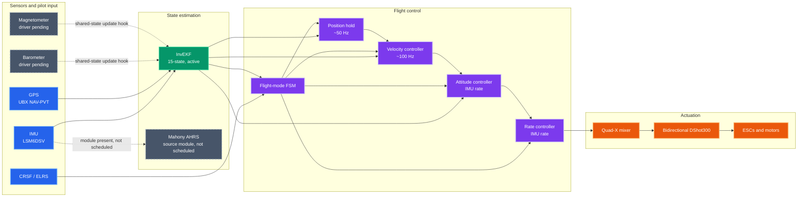
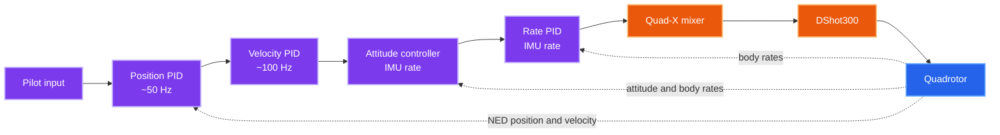
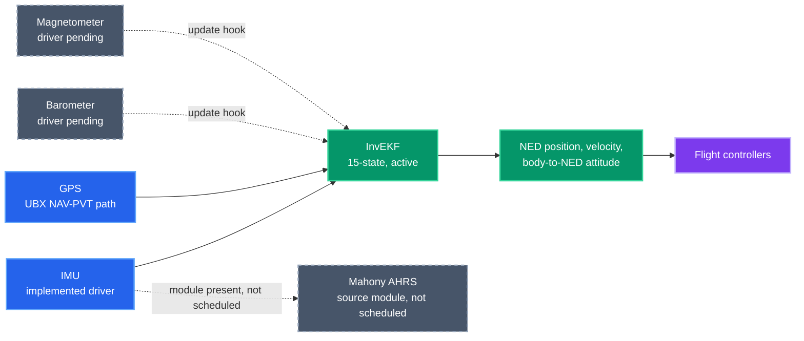

# Quadcopter Flight Controller

A research-oriented flight-control stack for a custom STM32-based quadrotor, developed from first principles to explore embedded systems, nonlinear state estimation, and multi-loop flight control.

Unlike hobby flight controllers built on an existing autopilot framework, this project is intended as an engineering and research platform. Its software is organized into estimation, control, communication, safety, and actuation modules, with explicit attention to coordinate frames and real-time scheduling.

> **Development status:** This is a source package, not a flight-qualified firmware release. The v1.1 InvEKF path and control stack are implemented in source, but the tree has no complete STM32Cube build project and has not been compiled or validated on target from this package. Barometer and magnetometer hardware drivers, MAVLink message generation, SD logging, current sensing, board initialization, and hardware tuning remain open work. Remove propellers during initial bring-up.

---

## System Architecture

Solid links show active source paths. Dotted links mark pending sensor hooks or included modules that are not connected to the runtime path.

The v1.1 system loop runs InvEKF for attitude and navigation. The Mahony AHRS implementation is also present in the source tree, but startup does not schedule it or route its output into the control loop.

---

## Features

### Flight modes

- **FPV / Acro:** pilot sticks command body angular rates; the rate loop drives the mixer.
- **Camera / stabilized:** pilot sticks command velocity; velocity and attitude loops stabilize the aircraft. Position hold is available only when requested and a valid GPS fix is present.
- **Failsafe and landing:** safety events can request failsafe; the FSM commands a bounded descent and checks barometer validity, altitude, and vertical speed before landing logic.

These paths are present in source and still require simulation and hardware validation.

### Control

The camera-mode cascade is shown below. FPV / Acro bypasses position, velocity, and attitude control and sends pilot rate commands to the rate loop.

- Cascaded position, velocity, attitude, and body-rate control.
- Quaternion attitude error in the body frame.
- PID derivative-on-measurement and integral anti-windup.
- Quad-X mixing with collective headroom/desaturation.
- DShot300 motor command path.
- A future NMPC-RTI interface scaffold under drone_fc/src/control/future/; it has no solver and is not connected to motor output.

### State estimation

The active v1.1 estimation path is summarized below. Dotted paths show pending sensor inputs or source modules that are not scheduled.

- **InvEKF:** 15-state right-invariant navigation filter, selected by the v1.1 system loop for attitude and navigation.
- **Mahony AHRS:** source module is present for high-rate attitude estimation; it is not currently scheduled or connected to the v1.1 control loop.
- High-rate nominal inertial propagation with decimated covariance prediction.
- UBX NAV-PVT GPS parser and local NED position/velocity update path.
- Barometer and magnetometer update methods and shared-state hooks; physical drivers and calibration are pending.

### Embedded system

- Target: STM32F722RET6, Cortex-M7, nominal 216 MHz.
- RTOS-facing code uses CMSIS-RTOS v2 APIs.
- IMU data-ready paced control loop, UART/EXTI callbacks, watchdog hook, and simulation state hooks.
- Hardware abstraction is not a substitute for the missing generated HAL/CubeMX project; confirm DMA, IRQ, clocks, and pin configuration in the target project.

---

## Repository Structure

The firmware is under drone_fc/:

- src/core/ — shared state, RTOS tasks, system startup, and callbacks.
- src/math/ — vector and quaternion math.
- src/estimation/ — active InvEKF navigation filter and Mahony AHRS source module.
- src/drivers/ — LSM6DSV IMU driver and startup-calibration helper.
- src/control/ — PID, rate, attitude, velocity, position, and future controller interface.
- src/flight_modes/ — flight-mode state machine.
- src/actuation/ — motor mixer and bidirectional DShot.
- src/communication/ — CRSF and UBX parsers.
- src/safety/ — monitor and fault handling.
- src/simulation/ — HIL/SIL sensor and output hooks.

## Documentation

| Document | Description |
|---|---|
| [ARCHITECTURE.md](ARCHITECTURE.md) | System data flow, scheduling, and subsystem implementation status |
| [Flight-controller setup](drone_fc/README.md) | Runtime rates, integration steps, and remaining hardware work |
| [Control and estimator reference](drone_fc/process.md) | Frames, loop equations, estimator architecture, and validation order |
| [Pin allocation](drone_fc/src/pins.md) | Intended pin map and unresolved board conflicts |
| [NMPC-RTI scaffold](drone_fc/src/control/future/README.md) | Scope and requirements for future solver integration |

## Hardware

| Component | Intended device/interface | Current software status |
|---|---|---|
| MCU | STM32F722RET6, LQFP64 | Target assumed by configuration |
| IMU | LSM6DSV320XTR, SPI1 | Driver source present; target validation pending |
| Barometer | MS5611, SPI1 | Driver not implemented |
| Magnetometer | QMC5883L, I2C1 | Driver/calibration not implemented |
| GPS | UBX receiver, USART1 | NAV-PVT parser and estimator path present |
| RC receiver | CRSF / ELRS, USART2 | Parser/task source present |
| ESC protocol | Bidirectional DShot300 | Output path present; telemetry conversion/board timing need validation |
| Telemetry | MAVLink over USB CDC | Task placeholder; message generation not implemented |
| Logging | microSD over SPI2 | Task placeholder; FatFS integration not implemented |

The intended pin assignment is summarized in [pins.md](drone_fc/src/pins.md). Check that file against the actual schematic before wiring or creating the CubeMX configuration.

## Development Roadmap

### Core source paths

- [x] IMU driver source
- [x] CRSF parser and receiver timeout
- [x] Cascaded PID controller and flight-mode FSM
- [x] InvEKF and Mahony AHRS source modules
- [x] UBX NAV-PVT parser and GPS fusion path
- [x] DShot command and mixer source
- [x] HIL/SIL state hooks
- [x] NMPC-RTI interface scaffold

A checked item means source exists; it does not mean it has passed target or flight validation.

### Integration and research work

- [ ] Complete STM32Cube/HAL/RTOS build project and peripheral initialization
- [ ] MS5611 and QMC5883L hardware drivers and calibration
- [ ] MAVLink message generation and USB transport
- [ ] SD/FatFS logging and log schema
- [ ] Current sensing, battery calibration, and telemetry
- [ ] Startup gyro calibration with timeout and failure handling
- [ ] Validate DShot telemetry decoding, ESC response, motor order, and direction
- [ ] Bench identification of mass, inertia, thrust, and motor response
- [ ] Tune controller and estimator parameters using measured data
- [ ] Validate failsafe and landing behavior in simulation, HIL, and restrained bench tests
- [ ] Add and validate return-to-home or rangefinder functions if required
- [ ] Implement and target-validate an NMPC solver before connecting the future scaffold

## Project Goals

This project is a long-term engineering platform for investigating:

- Flight dynamics and multirotor actuation
- Classical and modern control
- Sensor fusion and state estimation
- Embedded software architecture and deterministic real-time systems
- Robotics, simulation, and digital twins

The emphasis is on understanding the mathematics and engineering principles behind autonomous systems, while keeping implementation status and validation evidence explicit.

## License

This project includes [LICENSE.txt](LICENSE.txt).

