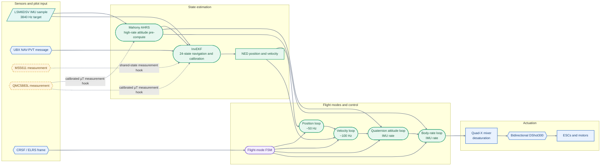
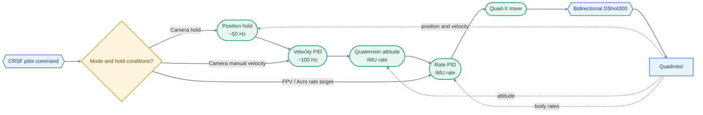
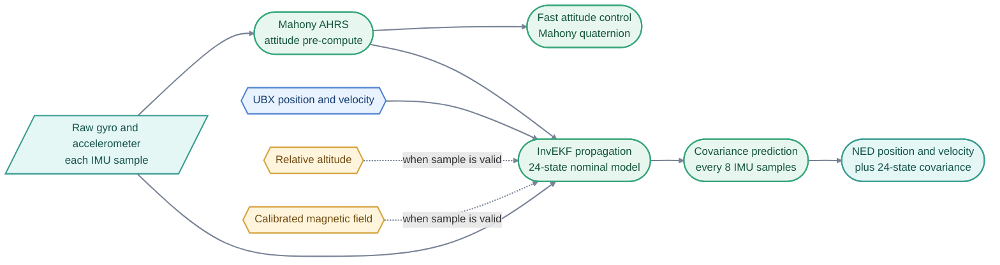

# Quadcopter Flight Controller

A research-oriented flight-control stack for a custom STM32 quadrotor. Drone OS is built as an embedded engineering platform for multirotor control, real-time software, and state estimation, with the active architecture kept explicit in source and documentation.

> **Source status:** v1.1 contains the Mahony high-rate attitude path, a 24-state left-invariant InvEKF navigation filter, cascaded control, UBX GPS fusion, safety hooks, and a future NMPC-RTI interface scaffold. The package is not a complete STM32Cube firmware project and is not flight-qualified. The MS5611 and QMC5883L drivers, generated board project, MAVLink messages, SD logging, and hardware calibration remain unfinished.

---

## System architecture

The diagram shows the intended final runtime architecture. It uses grouped lanes, semantic colors, and distinct component, process, and measurement shapes in the Myovena visual style. Solid links are wired in source; dashed links mark hardware feeds whose physical drivers are still pending. The full design, state machines, task sequences, and hardware boundary are in [ARCHITECTURE.md](ARCHITECTURE.md).



Mahony is deliberately retained as the fast attitude observer. It consumes every IMU sample and supplies attitude increments to InvEKF; the controller reads its low-latency attitude directly. InvEKF combines inertial propagation with GPS and any valid barometer or magnetometer data to estimate navigation and slower calibration states. This keeps the established high-rate attitude design while replacing the navigation Kalman filter.

The current code has a UBX GPS parser and fusion path. Barometer and magnetometer tasks are measurement consumers: their hardware acquisition and calibration drivers still need to be supplied. The diagram marks those inputs as pending rather than implying they are already live sensors.

---

## Flight modes and control

- **FPV / Acro:** receiver sticks command body angular rates; the inner rate loop drives the mixer.
- **Camera / stabilized:** the cascaded position, velocity, attitude, and rate loops stabilize position or pilot-commanded velocity.
- **Failsafe and landing:** safety events can request a bounded descent and the FSM checks its configured landing conditions. This source behavior still needs controlled validation.

The active cascade is:



The position loop is gated by the hold request and GPS validity. Without position hold, camera-mode sticks produce heading-relative velocity targets. FPV / Acro bypasses the outer loops. See [the control and estimator reference](drone_fc/process.md) for sign conventions and equations.

---

## State estimation

InvEKF retains the full **24 error coordinates**. The diagram shows how the high-rate attitude result and slower navigation measurements enter the estimator.



The 24 coordinates cover attitude, velocity, position, gyro bias, accelerometer bias, motor time constant, three-axis magnetometer bias, barometer bias, barometer scale, and three-axis NED wind. GPS fixes must have a valid 3D NAV-PVT fix, at least six satellites, and position DOP no greater than five by default. Only measurements with valid, correctly scaled inputs should update a state; APIs for motor lag and wind priors exist, but the runtime does not infer either from uncalibrated actuator commands.

---

## Embedded target and source layout

The target configuration assumes an STM32F722RET6 at 216 MHz with CMSIS-RTOS v2-facing task code, IMU data-ready pacing, peripheral callbacks, and a watchdog hook. The generated STM32Cube project, clock and DMA setup, board schematic, and target build files are not included here, so pin assignments and nominal rates remain integration targets.

```text
drone_fc/
├── inc/                  Target configuration and pin macros
├── src/
│   ├── core/             Shared state, RTOS tasks, system entry points
│   ├── math/             Fixed-size vectors and quaternions
│   ├── estimation/       Mahony AHRS and 24-state InvEKF
│   ├── drivers/          IMU and startup-calibration support
│   ├── communication/    CRSF and UBX parsers
│   ├── control/          PID cascade and future/NMPC-RTI scaffold
│   ├── flight_modes/     FPV, camera, failsafe, landing state machine
│   ├── actuation/        Quad-X mixer and bidirectional DShot
│   ├── safety/           Fault checks and watchdog integration
│   └── simulation/       HIL/SIL state and motor-output hooks
├── process.md            Estimation and controller equations
└── README.md             Firmware integration and status guide
```

The code is grouped by subsystem so estimation, control, communication, and actuation can be developed independently. [ARCHITECTURE.md](ARCHITECTURE.md) provides the expanded diagrams and data-flow explanation.

### Current implementation status

Source paths include the LSM6DSV driver, CRSF and UBX parsers, Mahony, InvEKF, cascaded PID controllers, flight-mode FSM, mixer, DShot interface, safety checks, and HIL/SIL hooks. Still needed are the physical barometer and magnetometer drivers, a complete generated target project, startup-calibration integration, MAVLink message generation, FatFS logging, current sensing, calibrated motor/ESC models, and hardware validation.

The [NMPC-RTI folder](drone_fc/src/control/future/README.md) is a fixed-interface scaffold. It has no optimization backend and is not connected to the active PID controller.

## Hardware reference

| Component | Intended part or interface | Source status |
|---|---|---|
| MCU | STM32F722RET6, LQFP64 | Target assumption in configuration |
| IMU | LSM6DSV320XTR, SPI1 | Driver source present; verify scale and axes on target |
| Barometer | MS5611, SPI1 | Driver not implemented |
| Magnetometer | QMC5883L, I2C1 | Driver and calibration not implemented |
| GPS | UBX receiver, USART1 | NAV-PVT parser and fusion path present |
| RC receiver | CRSF / ELRS, USART2 | Parser and task source present |
| ESC protocol | Bidirectional DShot300 | Output source present; target timing and telemetry need validation |
| Telemetry | MAVLink over USB CDC | Task placeholder; message generation not implemented |
| Logging | microSD over SPI2 | Task placeholder; FatFS integration not implemented |

Use [the pin allocation guide](drone_fc/src/pins.md) as a firmware-side proposal and reconcile it with the PCB schematic before connecting hardware.

## Documentation

| Document | What it covers |
|---|---|
| [Architecture](ARCHITECTURE.md) | Final planned runtime, colored data-flow diagrams, task boundaries, and integration status |
| [Firmware setup](drone_fc/README.md) | Source package scope, rates, target integration, and remaining work |
| [Control and estimator reference](drone_fc/process.md) | Frames, all 24 InvEKF states, update models, control signs, and tuning order |
| [Pin allocation](drone_fc/src/pins.md) | Intended pin map and unresolved board conflicts |
| [NMPC-RTI scaffold](drone_fc/src/control/future/README.md) | Future optimizer interface and work needed before integration |

## Development roadmap

- [x] High-rate Mahony attitude path and InvEKF navigation fusion path
- [x] 24-state estimator model and optional sensor/update APIs
- [x] Cascaded control, flight-mode FSM, mixer, and DShot source
- [x] UBX NAV-PVT parser and GPS position/velocity fusion path
- [x] Future NMPC-RTI interface scaffold
- [ ] Complete STM32Cube/HAL/RTOS target project and verify peripheral setup
- [ ] Implement MS5611 and QMC5883L hardware acquisition and calibration
- [ ] Integrate startup calibration with bounded timeout and failure handling
- [ ] Complete MAVLink transport and SD/FatFS logging
- [ ] Add current sensing, battery calibration, and calibrated actuator models
- [ ] Tune and validate estimates, controls, safety transitions, and DShot behavior on target

## Project goals

Drone OS is a long-term platform for flight dynamics, control theory, sensor fusion, embedded architecture, real-time execution, robotics, and simulation. It is intended to make the engineering assumptions visible and testable rather than imply validation from source code alone.

## License

This project is licensed under the MIT License. See [LICENSE.txt](LICENSE.txt).
