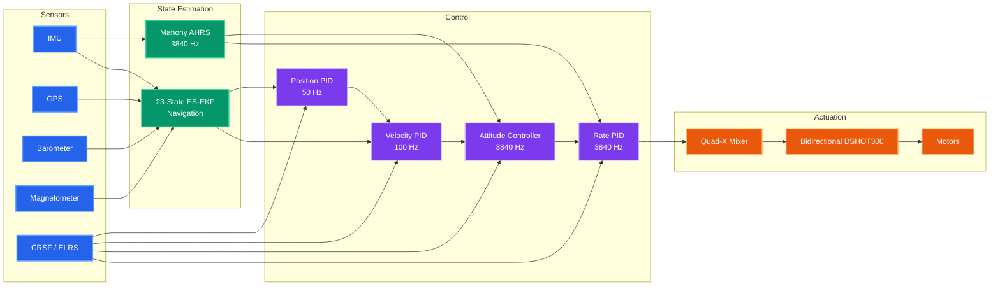
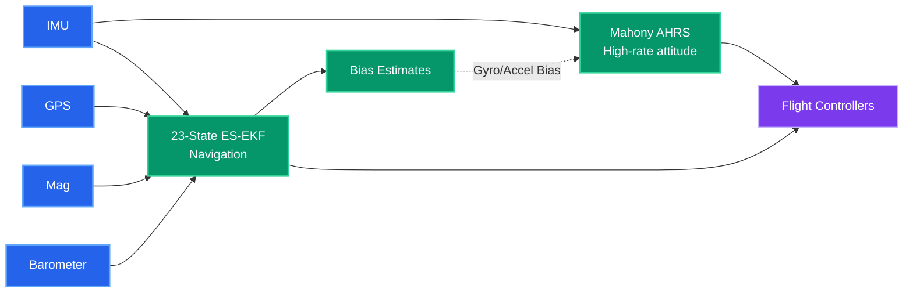

# Quadcopter Flight Controller

A research-oriented flight control stack for a custom STM32-based quadcopter, developed to explore modern embedded systems, nonlinear state estimation, and control theory from first principles.

Unlike many flight controllers built by extending existing autopilot frameworks, this project is designed from the ground up as a learning and engineering platform. Every subsystem—from sensor drivers to state estimation and motor control—is implemented with an emphasis on understanding the underlying mathematics, real-time constraints, and software architecture.

---

# System Architecture



---

## Features

### Flight Modes

 **Acro (FPV)** — Direct angular-rate control for manual flight.
 **Stabilized** — Full cascaded control with position hold, velocity control, attitude stabilization, and wind disturbance rejection.

### Control

- Four-layer cascaded control architecture

 ```mermaid
flowchart LR

RC["Pilot Input"]
POS["Position PID"]
VEL["Velocity PID"]
ATT["Attitude Controller"]
RATE["Rate PID"]
MIX["Mixer"]
ESC["Bidirectional DSHOT"]
PLANT["Quadrotor"]

RC --> POS
POS --> VEL
VEL --> ATT
ATT --> RATE
RATE --> MIX
MIX --> ESC
ESC --> PLANT

PLANT -. Position .-> POS
PLANT -. Velocity .-> VEL
PLANT -. Attitude .-> ATT
PLANT -. Angular Rate .-> RATE

classDef ctrl fill:#7c3aed,color:white,stroke:#c4b5fd,stroke-width:2px;
classDef plant fill:#2563eb,color:white,stroke:#60a5fa,stroke-width:2px;

class POS,VEL,ATT,RATE,MIX,ESC ctrl
class PLANT plant
```

- Quaternion attitude control
- Derivative-on-measurement PID
- Integral anti-windup
- Quad-X mixer
- Motor desaturation
- Bidirectional DSHOT300 support


### State Estimation

The estimator combines a high-rate attitude filter with a slower navigation-grade Error-State Extended Kalman Filter.



### Embedded System

- STM32F722RET6 (216 MHz Cortex-M7 + FPU)
- FreeRTOS (CMSIS-RTOS v2)
- Interrupt-driven control loop
- DMA-based peripheral transfers
- Hardware watchdog
- USB CDC telemetry
- Hardware abstraction layer supporting SIL and HIL simulation

---

# Repository Structure

```text
src/
├── actuation/
├── communication/
├── control/
├── core/
├── drivers/
├── estimation/
├── flight_modes/
├── math/
├── safety/
└── simulation/
```

The project is organised around functional subsystems rather than hardware peripherals, allowing each module to be developed and tested independently.

---

# Hardware

| Component | Device |
|-----------|--------|
| MCU | STM32F722RET6 |
| IMU | LSM6DSV320XTR |
| Barometer | MS5611 |
| Magnetometer | QMC5883L |
| GPS | UBlox-compatible receiver |
| RC Receiver | CRSF / ELRS |
| ESC Protocol | Bidirectional DSHOT300 |

Complete pin assignments and CubeMX configuration are available in the project documentation.

---

# Documentation

The repository contains detailed engineering documentation covering both implementation and theory.

| Document | Description |
|----------|-------------|
| **ARCHITECTURE.md** | Hardware architecture, software structure, pin assignments, task scheduling, and implementation details. |
| **process.md** | Controller design, estimator mathematics, tuning procedures, and engineering rationale. |

In addition to the repository documentation, the project is accompanied by a series of technical articles exploring topics such as:

- Rigid-body dynamics
- Quaternion mathematics
- Error-State Kalman Filtering
- Cascaded control systems
- Real-time embedded software
- Digital twins and simulation
- Mechatronic system design

---

# Project Goals

This project serves as a long-term engineering platform for investigating:

- Flight dynamics
- Classical and modern control theory
- Sensor fusion
- State estimation
- Embedded software architecture
- Real-time systems
- Robotics
- Simulation and digital twins

The emphasis is on developing a rigorous understanding of the mathematics and engineering principles underlying autonomous systems rather than simply producing a functional flight controller.

---

# Future Work

Planned developments include:

- Hardware-in-the-loop (HIL) simulation
- Software-in-the-loop (SIL) simulation
- Online parameter identification
- Closed-loop thrust estimation using bidirectional DSHOT telemetry
- Adaptive control
- Mission planning and autonomous navigation
- Vision and rangefinder integration

---

# License

Released under the MIT License.
